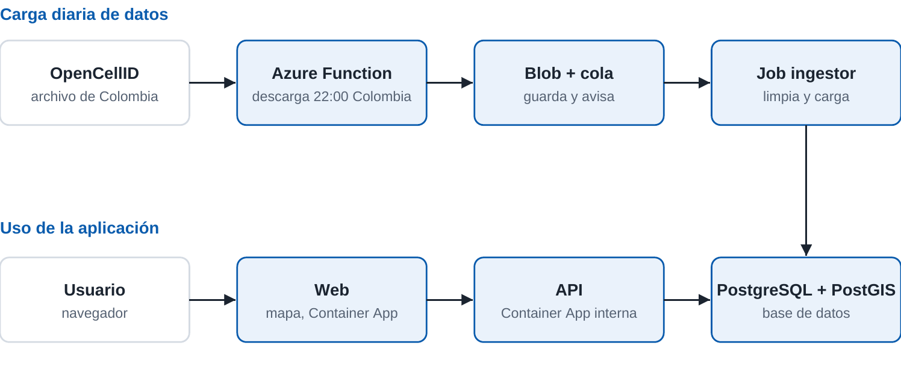

# Plataforma cloud-native de celdas para Colombia

> Reemplaza todo lo que esté entre `[corchetes]`. Solo publica resultados que hayas medido.

## 1. Caso de negocio
**Cliente:** [nombre del cliente ficticio o académico]. Este proyecto es académico: el cliente es un caso de estudio.

**Problema:** una empresa de rastreo de flotas pierde la ubicación de sus dispositivos cuando falla el GPS y no sabe qué operador conviene en cada zona.

**Solución:** una plataforma propia que descarga los datos abiertos de OpenCellID para Colombia, los guarda, estima la ubicación de un dispositivo a partir de las celdas que detecta y muestra las celdas en un mapa.

**Métricas de éxito**
| Métrica | Objetivo | Resultado |
|---|---|---|
| Latencia p95 de `/v1/cells/nearby` | menos de 800 ms | [medido] |
| Errores durante la prueba de carga | menos de 1 % | [medido] |
| Recuperación tras borrar un pod | menos de 60 s | [medido] |

## 2. Trabajo realizado
- [Qué hiciste, con enlaces a las carpetas y a las evidencias de `docs/evidencia/`]

## 3. Arquitectura


| Requisito | Cómo se cumple |
|---|---|
| Microservicios | `api`, `web` e `ingestor` se despliegan por separado y se comunican por API o cola |
| Contenedores y orquestación | Docker, manifiestos de `k8s/` y Azure Container Apps |
| CI/CD | `.github/workflows/` |
| Serverless | Azure Function diaria y escalado a cero |
| Resiliencia y escalado | Réplicas, chequeos de salud, autoescalado, reintentos de cola y copia propia de los datos |

## 4. Decisiones técnicas
| Decisión | Motivo | Costo aceptado |
|---|---|---|
| Copia propia de los datos | La API de OpenCellID da 1.000 créditos diarios y recomienda descargas para trabajo masivo | Datos actualizados una vez al día |
| Container Apps en la nube | Consume menos crédito que un clúster AKS encendido | Parte de la configuración depende de Azure |
| Kubernetes para portabilidad | Los manifiestos de `k8s/` funcionan fuera de Azure | Se prueba en local |

## 5. Cómo ejecutarlo
```bash
cp .env.example .env
docker compose up -d --build
```
Web: http://localhost:8080 · Documentación de la API: http://localhost:8000/docs

## 6. Resultados y costos
- Prueba de carga: [resultados]
- Prueba de fallas: [resultados]
- Consumo de crédito de Azure: [USD por semana]

## 7. Limitaciones
- Las ubicaciones son estimadas y no representan torres confirmadas.
- Las descargas incluyen celdas vistas en los últimos 18 meses.
- La cobertura de los datos es desigual porque depende de la comunidad.

## 8. Licencia de los datos
Cell tower data from [OpenCellID](https://opencellid.org), licensed under [CC BY-SA 4.0](https://creativecommons.org/licenses/by-sa/4.0/).
